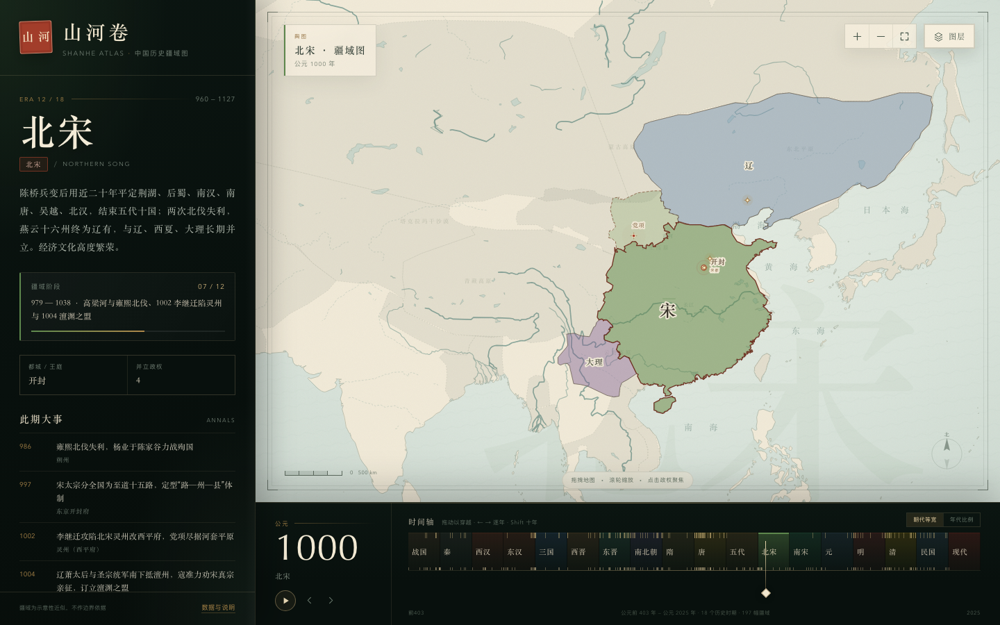

# 山河卷 · 中国历史疆域图

**在线地址：https://xiaocoer-cloud.github.io/shanhe-atlas/**

一幅可以拖动时间轴的中国历史地图。从公元前 403 年三家分晋到 2025 年，十八个历史时期、一百九十余幅疆域阶段，在同一个可缩放的地图里连续展开。

**直接双击 `index.html` 即可使用**，无需安装依赖、无需联网。整个页面（包含全部疆域数据）都在这一个文件里。



## 可以做什么

- **拖动时间轴**：在底部朝代带任意拖动，年份、朝代、疆域阶段实时联动；也可点击任意朝代直接跳转。
- **两种时间刻度**：默认「朝代等宽」，让秦、三国这类短命王朝也有一席之地；可切换为「年代比例」，按真实年数展开。
- **自动播放**：按空格键或点击播放按钮，约一分钟走完两千四百年。
- **疆域与政权**：主政权、并立政权、都护/羁縻、四邻以不同层级呈现；悬停高亮，点击可聚焦到该政权。
- **地图操作**：拖拽平移，滚轮缩放，右上角按钮复位；图层可开关河流、四邻、事件、长城。
- **历史纪事**：每期重要事件随年份出现，点击事件可跳转到对应年份；地图上的金色标记可悬停查看。
- **移动端**：侧栏默认收起，保留整屏地图与时间轴；点右上角箭头展开朝代说明。

### 快捷键

| 按键 | 作用 |
| --- | --- |
| `←` / `→` | 前后一年 |
| `Shift` + `←` / `→` | 前后十年 |
| `空格` | 播放 / 暂停 |
| `Home` / `End` | 跳到起点 / 终点 |
| `+` / `-` / `0` | 放大 / 缩小 / 复位地图 |
| `Esc` | 关闭弹窗或图层菜单 |

## 目录

```
index.html        最终单文件成品
atlas-data.json   整理后的疆域、阶段、事件与底图数据
src/              模板、样式、交互源码
build-data.mjs    从公开数据源生成 atlas-data.json
build-page.mjs    把源码与数据打包为 index.html
preview.png      桌面端截图
```

重新构建：

```bash
node build-data.mjs   # 首次会自动下载数据到 .cache/
node build-page.mjs
```

## 数据与授权

- **历史政权轮廓**：改编自开源项目 [江山时序 / Chronicles of the Realm](https://github.com/DeanChensj/jiangshan-map)（GPL-3.0）。该项目轮廓源自 [historical-basemaps](https://github.com/aourednik/historical-basemaps)，并据史籍校订。
- **海岸线、河流、湖泊**：[Natural Earth](https://www.naturalearthdata.com/)（公有领域）。
- **本项目代码与整理数据**：GPL-3.0，见 [LICENSE](LICENSE)。

### 关于准确性

历史疆域没有唯一、精确的边界。本图中的所有轮廓均为**示意性近似**，用于呈现疆域大势与历史变迁，不可作为边界依据。部分政权并立、羁縻、都护与藩属关系以简化方式表达。若用于教学、出版或正式展示，请核对原始史料与权威历史地图集。
